 

# ⚡ Awesome Automation Engine 🚀

> 🌟 A curated directory of battle-tested enterprise SaaS automation platforms and open-source workflow orchestration engines. Discover, compare, and deploy modern automation solutions for Robotic Process Automation (RPA), data pipelines, code orchestration, and iPaaS integrations.

---

## 📑 Table of Contents
- [🌐 Sector Overview & Market Dynamics](#-sector-overview--market-dynamics)
- [💼 Commercial & SaaS Automation Platforms](#-commercial--saas-automation-platforms)
- [🔓 Open-Source Workflow & Automation Engines](#-open-source-workflow--automation-engines)
- [🧭 Choosing the Right Automation Engine](#-choosing-the-right-automation-engine)
- [🤝 Contributing](#-contributing)
- [📄 License](#-license)

---

## 🌐 Sector Overview & Market Dynamics

The global enterprise workflow automation and Robotic Process Automation (RPA) market is estimated at **$16.8 billion to $21.5 billion** and is projected to expand at a compound annual growth rate (**CAGR**) of over 23% toward $66 billion by 2032. 

The industry demonstrates a **moderately fragmented, dual-tier market structure**: while enterprise-wide digital workflows and cloud orchestration are heavily influenced by mega-cap ecosystem platforms (ServiceNow, Microsoft Power Automate, Salesforce MuleSoft), the middle-tier and developer-first niches remain vibrant and competitive with best-of-breed specialized vendors (Zapier, Make, Workato) and self-hosted open-source challengers disrupting vendor lock-in.

---

## 💼 Commercial & SaaS Automation Platforms

Below is a comparison of top enterprise SaaS automation and integration platforms, ranked descending by corporate size, annual revenue, and market valuation:

| 🏢 Platform | 💰 Company Size / Valuation / Revenue | 🏷️ Pricing (Starting Tier) | 🎁 Free Tier / Trial Limits | 🎯 Primary Use Case & Key Highlights |
| :--- | :--- | :--- | :--- | :--- |
| [**Microsoft Power Automate**](file:///https://powerautomate.microsoft.com/) | **$3.1+ Trillion Market Cap** (Microsoft parent revenue ~$245B/year) | **$15/user/month** (Power Automate Premium plan; or $0.60 per flow run on pay-as-you-go Azure subscription) | **90-day free trial** with full premium connectors, desktop RPA flow execution, and 5,000 AI Builder credits/month | Low-code RPA, cloud flows, and native Microsoft 365 / Azure enterprise ecosystem orchestration. |
| [**ServiceNow Automation Engine**](file:///https://www.servicenow.com/) | **$185+ Billion Market Cap** (~$10.9B ARR) | **~$100/user/month** (Enterprise custom billing, typical starting entry ~$1,200/month baseline contract) | **Unlimited Personal Developer Instance (PDI)** at developer.servicenow.com (hibernates after 10 days of inactivity, re-activable) | Enterprise digital workflows, IT Service Management (ITSM), and deep legacy integration spoke automation. |
| [**UiPath**](file:///https://www.uipath.com/) | **$7.5+ Billion Market Cap** (~$1.4B ARR) | **$25/user/month** (UiPath Business Automation Basic plan for desktopattended bots; Studio starts at $420/month) | **Free Community Plan forever**: 2 Studio licenses, 1 attended robot, 1 unattended robot, and 100 Orchestrator actions/month | Heavyweight Robotic Process Automation (RPA), optical character recognition (OCR), and computer vision UI automation. |
| [**Workato**](file:///https://www.workato.com/) | **$5.7 Billion Valuation** (~$300M+ ARR) | **$10,000/year base platform** + ~$8/recipe (Starting entry bundles begin at ~$1,250/month with 10k task allowance) | **30-day full feature free trial** with 500 recipe transactions and dedicated community connector access | Enterprise Integration Platform as a Service (iPaaS), cross-SaaS event choreography, and data pipeline triggers. |
| [**Zapier**](file:///https://zapier.com/) | **$5.0 Billion Valuation** (~$310M ARR) | **$19.99/month billed annually** ($29.99/month monthly) for Professional plan with 750 tasks and multi-step Zaps | **Free Forever Plan**: 100 tasks/month, 5 single-step Zaps, and 15-minute standard polling update intervals | Visual consumer and SMB app-to-app workflow automation with 6,000+ pre-built SaaS connector integrations. |
| [**Make (formerly Integromat)**](file:///https://www.make.com/) | **$3.0+ Billion Celonis Valuation** (Celonis acquired Make parent Integromat) | **$9/month billed annually** ($10.59 monthly) for Core plan with 10,000 operations/month | **Free Forever Plan**: 1,000 operations/month, 100 MB data transfer, and minimum 15-minute execution interval | Flexible visual canvas, multi-branch JSON data manipulation, webhook handling, and affordable iPaaS execution. |

---

## 🔓 Open-Source Workflow & Automation Engines

Top battle-tested open-source workflow and automation repositories, ranked descending by GitHub star count:

| 💻 Open-Source Project | ⭐ GitHub Stars | 🧰 Architecture / Language | 🚀 Description & Core Strengths |
| :--- | :---: | :--- | :--- |
| [**n8n**](file:///https://github.com/n8n-io/n8n) |  | TypeScript / Node.js | Fair-code visual node-based workflow automation engine connecting 400+ apps with native JavaScript code execution and webhook triggers. |
| [**Huginn**](file:///https://github.com/huginn/huginn) |  | Ruby | Open-source alternative to IFTTT/Zapier for building software agents that monitor web events, scrape changes, and trigger automated HTTP tasks. |
| [**Apache Airflow**](file:///https://github.com/apache/airflow) |  | Python | The de-facto standard open-source platform to programmatically author, schedule, and monitor complex batch data workflows as Directed Acyclic Graphs (DAGs). |
| [**Kestra**](file:///https://github.com/kestra-io/kestra) |  | Java | Modern declarative YAML-based orchestrator and data pipeline engine handling both event-driven microservices and scheduled batch tasks with an embedded UI. |
| [**Activepieces**](file:///https://github.com/activepieces/activepieces) |  | TypeScript | Modular, open-source Zapier alternative designed for self-hosters with a visual builder, enterprise-ready sandboxing, and community TypeScript pieces. |
| [**Prefect**](file:///https://github.com/prefecthq/prefect) |  | Python | Pythonic workflow orchestrator built for resilience, instant task retries, dynamic parameters, and zero-infrastructure local-to-cloud execution. |
| [**Temporal**](file:///https://github.com/temporalio/temporal) |  | Go | Resilient, distributed code-as-configuration execution engine that ensures mission-critical stateful microservice workflows survive server crashes and network outages. |
| [**Node-RED**](file:///https://github.com/node-red/node-red) |  | JavaScript / Node.js | Low-code flow-based programming environment originally developed by IBM, widely adopted for IoT telemetry, edge devices, and event-driven automation. |
| [**Windmill**](file:///https://github.com/windmill-labs/windmill) |  | Rust / TypeScript / Python | Ultra-fast developer platform and alternative to Retool/Temporal that turns Python, TypeScript, Bash, and SQL scripts into workflows and internal UIs. |
| [**Argo Workflows**](file:///https://github.com/argoproj/argo-workflows) |  | Go / Kubernetes CRD | Cloud-native container orchestration engine implemented as a Kubernetes CRD, ideal for machine learning pipelines, ETL, and CI/CD operations. |
| [**Dagster**](file:///https://github.com/dagster-io/dagster) |  | Python | Next-generation asset-oriented data orchestrator that models data dependencies, tracks lineage, and provides built-in testing and observability. |
| [**Automatisch**](file:///https://github.com/automatisch/automatisch) |  | JavaScript / React | Self-hosted business automation tool and open-source Zapier competitor designed for GDPR-compliant on-premise execution without cloud telemetry. |

---

## 🧭 Choosing the Right Automation Engine

- **For Enterprise IT & Office 365 Workflows:** Choose **Microsoft Power Automate** or **ServiceNow** for seamless ecosystem integrations and compliance guarantees.
- **For Low-Code API & Webhook Choreography:** Choose **n8n** or **Activepieces** for open-source self-hosting, or **Zapier** / **Make** for managed multi-app connectivity.
- **For Large-Scale Batch Data Pipelines & ETL:** Choose **Apache Airflow** or **Dagster** for mature Python-native DAG orchestration and data asset lineage.
- **For Resilient Distributed Microservices:** Choose **Temporal** to write indestructible workflows with durable execution guarantees in Go, Python, TypeScript, or Java.
- **For Kubernetes-Native Container Pipelines:** Choose **Argo Workflows** for running containerized compute jobs directly on K8s clusters.

---

## 🤝 Contributing

Contributions are always welcome! 💖

1. 🍴 Fork the repository.
2. 🌿 Create your feature branch (`git checkout -b feature/awesome-engine`).
3. 💾 Commit your changes (`git commit -m 'feat: add new automation engine'`).
4. 📤 Push to the branch (`git push origin feature/awesome-engine`).
5. 🔍 Open a Pull Request.

---

## 📄 License

This repository is licensed under the [MIT License](file:///C:/Users/ishan/Documents/Projects/Awesome-Automation-Engine/LICENSE).
